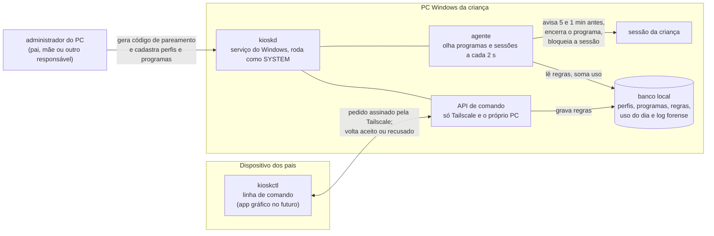
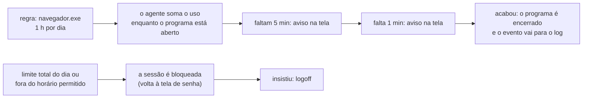

# kiosk — controle parental doméstico para Windows

O **kiosk** ajuda pais e responsáveis a definir **quais programas** cada criança ou adolescente pode usar no PC, **por quanto tempo** e **em quais horários**. Ele avisa antes de agir e, quando o tempo acaba, encerra o programa ou bloqueia a sessão. Cada criança tem a própria conta do Windows, e as regras valem para ela.

Tudo roda **no próprio PC**. Não há nuvem, conta online nem envio de dados das crianças para fora. Os pais administram de outro dispositivo pela [Tailscale](https://tailscale.com), uma rede privada entre os aparelhos da família.

> **Pré-lançamento (0.0.x).** Funciona e foi testado num PC Windows real, mas ainda tem lacunas conhecidas, como o logoff depois de insistir e a tela de bandeja. **Não use como única proteção.** Veja o [CHANGELOG](CHANGELOG.md) e o [ROADMAP](docs/ROADMAP.md), que mostra a maturidade de cada parte.

## Como funciona, num olhar



1. **Serviço (`kioskd`)**: fica no PC da criança como serviço do Windows. Inicia com a máquina e volta sozinho se cair; a conta da criança não consegue pará-lo. Tem duas partes:
   - o **agente**, que aplica as regras;
   - a **API**, que recebe os comandos dos pais.
2. **Cliente (`kioskctl`)**: fica no computador dos pais (Windows ou Linux). Cria, ativa, revoga e ajusta regras e consulta o uso do dia e o histórico.
3. **Pareamento**: um administrador do PC gera um código de 8 caracteres, válido por 5 minutos e de uso único, e o digita no cliente. A partir daí, cada pedido do cliente é **assinado** e conferido pelo serviço. Pedido sem assinatura, repetido ou de dispositivo revogado é recusado. Só administrador gera código, então a criança não consegue parear um cliente para si.
4. **Log forense**: toda mudança e toda recusa ficam registradas num histórico que não pode ser editado nem apagado antes de 90 dias.

### O que acontece quando o tempo acaba



## Conceitos

| Termo | O que é |
|---|---|
| **Perfil** | Uma criança, ligada à conta dela no Windows. Pode ter limite diário total e horários permitidos por dia da semana. |
| **Programa (app)** | Identificado pelo nome do `.exe`. Pode ser **monitorado** (padrão: só é restringido se houver regra), **isento** (nunca é encerrado) ou **ignorado** (fica fora do controle). |
| **Regra** | Liga um perfil a um programa: limite diário, janela de horário e validade opcional. Nasce pendente e passa a valer quando é ativada. |
| **Responsáveis** | Os administradores do PC. Todos gerem todas as crianças, e cada um pareia o próprio cliente. |

Quando duas regras se aplicam, vale a mais restritiva. Programa monitorado sem regra é permitido, e dia sem horário definido não tem restrição.

## Começando

1. Baixe o pacote do [release mais recente](https://github.com/jefersonlop3s/kiosk-engine/releases) e confira o SHA-256 no `SHA256SUMS.txt`.
2. Crie uma conta local **padrão**, sem administrador, para cada criança.
3. Num PowerShell **como Administrador**, na pasta extraída, instale o serviço:
   ```powershell
   .\kioskd.exe instalar --escutar "SEU_IP_TAILSCALE:8443,127.0.0.1:8443"
   ```
4. Cadastre as crianças, os programas e as regras, gere o código e pareie o cliente.

O passo a passo completo, com cada comando, está no [runbook](docs/runbooks/api-e-cli.md). O fluxo de cada comando, com o caminho da informação entre o cliente e o serviço, está nos [fluxogramas dos comandos](docs/architecture/fluxos-dos-comandos.md).

## Plataformas

| | Hoje | Planejado |
|---|---|---|
| Serviço (PC da criança) | Windows 10/11 | Linux, macOS e Android, depois que o Windows amadurecer ([E-009](docs/epics/E-009-servico-linux.md), [E-010](docs/epics/E-010-servico-macos.md), [E-011](docs/epics/E-011-servico-android.md)) |
| Cliente dos pais | `kioskctl` no Windows e no Linux | App gráfico no Windows, Linux e macOS ([E-008](docs/epics/E-008-cliente-grafico-dos-pais.md)); app no celular ([E-006](docs/epics/E-006-app-mobile-administracao.md)) |

## Documentação

- [Arquitetura](docs/architecture/README.md) e [decisões (ADRs)](docs/adr/ADR-INDEX.md).
- [ROADMAP](docs/ROADMAP.md), com a porcentagem de cada épico, e [pendências](docs/PENDING.md).
- [Histórico de entregas](docs/CONCLUSION.md) e [organização da documentação](docs/README.md).

## Desenvolvimento

Rust (edition 2024), SQLite via `sqlx` e `tokio`.

```bash
cargo test
```

```bash
git config core.hooksPath .githooks
```

O segundo comando ativa os gates locais do harness: formatação, clippy, testes e verificação da documentação. O CI roda em Ubuntu e Windows; no Windows, um teste instala o serviço de verdade. Regras para contribuir, inclusive para agentes de IA, estão no [AGENTS.md](AGENTS.md).

## Licença

[GPL-2.0-only](LICENSE).
